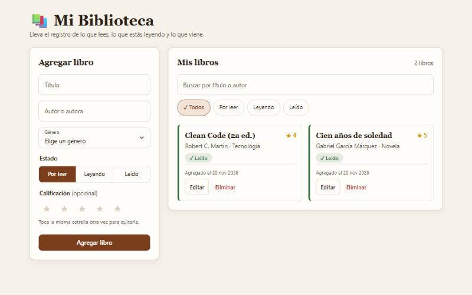
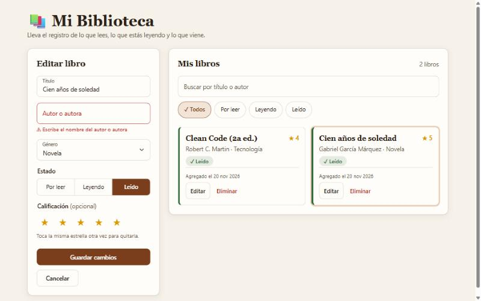
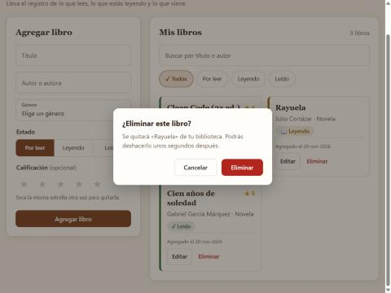
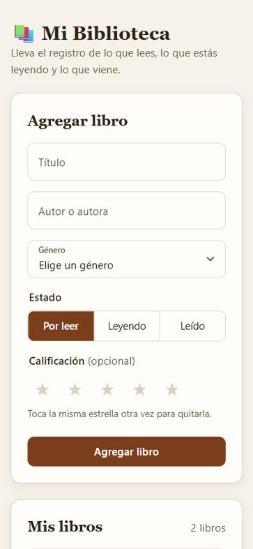

# 📚 Mi Biblioteca

Aplicación web CRUD para llevar el registro de tus libros: los que vas a leer, los que estás leyendo y los que ya
leíste. Todo el desarrollo se hizo guiado por prompts de IA (Claude Code), usando un conjunto propio de
[skills de desarrollo](https://github.com/JuanJo24S/claude-develop-skills) para el flujo de Git, el código limpio y
el diseño de la interfaz.

> Trabajo práctico del seminario **Gestión de Software Ágil asistido por Inteligencia Artificial**.



## Qué hace (CRUD)

| Acción | En la app | Dónde está en el código |
|---|---|---|
| **Create** | Formulario «Agregar libro»: título, autor, género, estado y calificación opcional. Valida cada campo y muestra el error junto a él. | `BookService.addBook` → `createBook` (dominio) → `repository.save` |
| **Read** | Lista de cards ordenada del más reciente al más antiguo, con búsqueda por título o autor (ignora tildes y mayúsculas) y filtro por estado. | `BookService.listBooks` / `getBook` → `repository.findAll` |
| **Update** | Botón «Editar» en cada card: carga el libro en el mismo formulario, que cambia a «Guardar cambios». `Esc` o «Cancelar» salen sin guardar. | `BookService.editBook` → `updateBook` (dominio) → `repository.save` |
| **Delete** | Botón «Eliminar» con diálogo de confirmación y opción «Deshacer» durante 5 segundos. | `BookService.removeBook` / `restoreBook` → `repository.delete` |

Los datos se guardan en el `localStorage` del navegador, así que siguen ahí al recargar la página. Si abres la app en
dos pestañas, los cambios de una se ven en la otra.

## Tecnologías

- **HTML5**: estructura semántica, `<template>` para las cards y `<dialog>` para la confirmación.
- **CSS3**: variables (tokens de diseño), Grid y Flexbox, etiquetas flotantes y diseño responsive sin frameworks.
- **JavaScript (ES Modules)**: sin librerías.
- **localStorage**: persistencia en el navegador.
- **Node.js**: solo para servir los archivos en local (`scripts/serve.js`, sin dependencias) y correr las pruebas con
  `node:test`.
- **IA**: Claude Code con las skills `git-workflow`, `clean-code`, `secrets-management`, `forms`, `cards` y
  `responsive`.

## Cómo ejecutarlo

Requisito: [Node.js](https://nodejs.org/) 18 o superior. No hay que instalar dependencias.

```bash
git clone <url-de-este-repositorio>
cd mi-biblioteca
npm start
```

Abre <http://localhost:3000>. Para usar otro puerto: `PORT=4000 npm start` (en PowerShell:
`$env:PORT=4000; npm start`).

> ¿Por qué un servidor y no abrir `index.html` con doble clic? Los módulos de JavaScript (`import`/`export`) no
> cargan desde `file://` por seguridad del navegador.

Pruebas:

```bash
npm test
```

## Estructura del código

El código sigue una arquitectura por capas (hexagonal), como pide la skill `clean-code`: las reglas de negocio no
dependen del navegador, así que se prueban con Node sin abrir la página.

```
mi-biblioteca/
├── index.html                    # Estructura de la página
├── src/
│   ├── domain/book.js            # Entidad Libro: normalización y validación (sin DOM ni storage)
│   ├── application/book-service.js   # Casos de uso: agregar, listar, editar, eliminar, deshacer
│   ├── infrastructure/local-storage-book-repository.js  # Guarda y lee en localStorage
│   ├── interfaces/
│   │   ├── book-form.js          # Formulario (Create / Update) y sus errores
│   │   ├── book-list.js          # Lista de cards, búsqueda y filtro (Read / Delete)
│   │   └── feedback.js           # Toast y diálogo de confirmación
│   ├── main.js                   # Une las piezas y conecta eventos con casos de uso
│   └── styles.css
├── tests/                        # 19 pruebas con node:test
├── scripts/serve.js              # Servidor estático mínimo
└── docs/screenshots/
```

El flujo de una acción: la interfaz lee el formulario → `main.js` llama al caso de uso → el dominio valida → el
repositorio guarda → la interfaz vuelve a pintar la lista y muestra un mensaje.

## Capturas

| Edición con validación | Confirmación al eliminar | Celular |
|---|---|---|
|  |  |  |

## Prompts usados

Cada prompt con lo que pedí y para qué. El historial de commits (`git log`) muestra cómo avanzó el código después de
cada uno.

### 1. Generar el proyecto con mis skills

> Hola, necesito ayuda con esto: *[enunciado completo del trabajo práctico]*. Mira, en mi GitHub hay un repo que es
> `git@github.com:JuanJo24S/claude-develop-skills.git`; clónalo y usa estas skills para el desarrollo de esta web.
> Necesito también subir todo a un GitHub; haz un `git init`.

- **Qué pedí:** que la IA leyera el enunciado, clonara mi repositorio de skills y construyera el CRUD siguiéndolas.
- **Para qué:** que el código no saliera "genérico", sino con mis propias reglas: ramas y commits convencionales
  (`git-workflow`), capas separadas y pruebas (`clean-code`), formulario con etiquetas flotantes y errores junto a
  cada campo (`forms`), cards con jerarquía (`cards`) y diseño que no se desborda en el celular (`responsive`).
- **Qué ajusté:** revisé el resultado en el navegador; el formato de fecha salía «20 de nov de 2026» y se corrigió a
  «20 nov 2026» como pide la skill `cards`, y el script de pruebas se cambió a `tests/*.test.js` porque con la
  carpeta sola fallaba en Node 24.

<!-- Agrega aquí los siguientes prompts con el mismo formato: prompt, qué pedí, para qué, qué ajusté. -->

## Uso responsable de la IA

La IA generó el código a partir de mis prompts y mis skills, pero las decisiones fueron mías: el tema de la app, las
reglas que debía seguir, la revisión de cada cambio en el navegador y los ajustes posteriores. Cada archivo tiene
comentarios que explican **por qué** se hizo así, y puedo explicar cada parte del CRUD con mis palabras.

## Autora

[Dhanna-Yeraldine](https://github.com/Dhanna-Yeraldine)

Skills de desarrollo usadas: [claude-develop-skills](https://github.com/JuanJo24S/claude-develop-skills), de Juan
Camacho (JuanJo24S).
